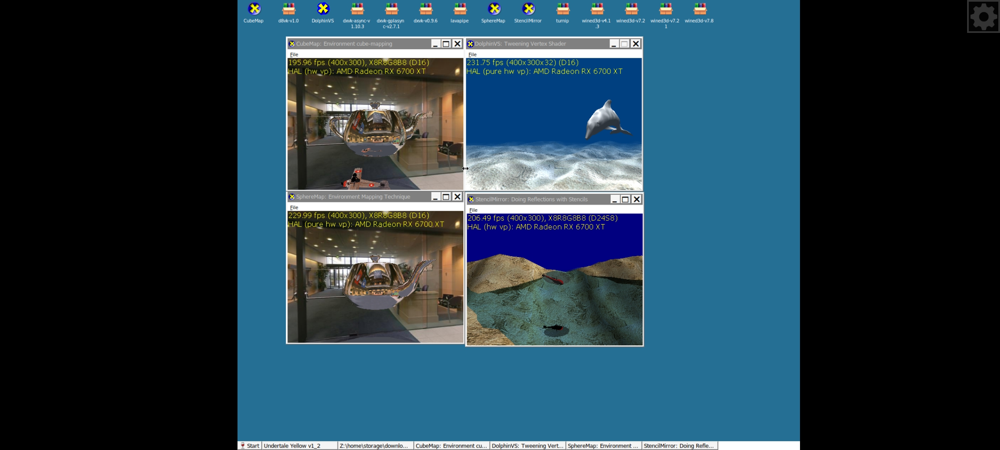

<!-- markdownlint-disable -->
<!-- cspell:disable -->

> [!NOTE]
> 当前为 v0.4.1-beta 频道

> [!WARNING]
> 当前模拟器仍处于测试阶段，可能存在尚未发现的错误。如有不便，我们深表歉意，并感谢你的理解与支持。

# GQE-emulator

GQE 是一款用于在 Android ARM64 设备上运行 Windows x86_64 程序的模拟器，无需获取 Root 权限。它依赖 [Termux](https://github.com/termux/termux-app)、[Termux-X11](https://github.com/termux/termux-x11) 和 [InputBridge](https://inputbridge.net/)。



希望改进项目？欢迎提交拉取请求；我们接受具有建设性的贡献。

# 安装

在 Termux 中执行以下命令，并确保使用 64 位版本。

```bash
curl -s -o g https://v6.gh-proxy.org/https://raw.githubusercontent.com/ocnedkf/GQE-emulator/refs/heads/v0.4.1-beta/install-sh && chmod +x g && ./g
```

# 启动 GQE

执行：

```bash
start-gqe
```

> [!IMPORTANT]
> 使用 GQE 时，请确保系统有足够的可用内存，以防 Termux 在后台被系统终止。

# 终止 GQE

关闭所有 GQE 窗口，或执行：

```bash
kill-gqe
```

# GQE 设置

运行 `start-gqe -s` 或 `start-gqe --settings` 可打开设置菜单。

菜单提供以下选项：

- **显示：**选择预设分辨率，或使用 `宽度x高度` 格式输入自定义分辨率。也可以设置 DPI 值。如果分辨率为空或无效，GQE 会回退到 `1024x768`；无效的 DPI 值会被忽略。
- **音频：**输入并保存音频延迟，单位为毫秒。
- **Wine：**配置 DLL 替代规则或查看 Wine 信息。
- **盘符：**添加、删除或查看盘符映射。
- **更多设置：**保存时区 ID、编辑配置文件、选择 WineD3D 或 VirGL 图形后端，以及设置自定义 BMP 壁纸。

# GQE 配置

> [!TIP]
> 在开始菜单中，可以通过 `Install` 和 `Programs` 选项调整 Mesa 与 D3D 文件，也可以使用 winecfg 等工具快速完成配置。

配置文件位于：

```text
/storage/emulated/0/.gqe-start
```

| 文件名 | 说明 |
| --- | --- |
| `all_var.txt` | GQE 全局环境变量 |
| `dxvk_settings` | DXVK 配置文件 |
| `mesa_var.txt` | Mesa Gallium 驱动选择 |
| `mesa_var_v.txt` | Mesa Vulkan 驱动选择 |
| `mesa_var_f.txt` | Vulkan ICD JSON 清单文件的路径 |
| `log.txt` | Wine 运行时日志文件 |

# 修复 GQE

运行 `start-gqe -f` 可修复 Wine 容器，或将其重新初始化。

> [!TIP]
> 如果只想重新初始化 Wine 容器，请先删除该容器，再执行修复命令：
>
> ```text
> $HOME/.gqe-data-v0.4/.wine
> ```

# 卸载

执行：

```bash
curl -s -o u https://v6.gh-proxy.org/https://raw.githubusercontent.com/ocnedkf/GQE-emulator/refs/heads/v0.4.1-beta/uninstall-gqe && chmod +x u && ./u
```

> [!WARNING]
> 此命令会删除 GQE及其中存储的所有数据。请勿在未安装 GQE 的情况下执行。

# 设备要求

- Android ARM64 设备
- Android 8 或更高版本
- 至少约 5.5 GB 可用存储空间

# 第三方应用

- [7-Zip](https://7-zip.org/) - GNU LGPL v2.1 或更高版本；7z.dll 还包含 BSD-2-Clause/BSD-3-Clause 组件，以及 unRAR 的许可证限制。
- [Box64（定制版）](https://github.com/Pipetto-crypto/box64) - MIT License
- [D7VK](https://github.com/WinterSnowfall/d7vk) - zlib License
- [D8VK](https://github.com/AlpyneDreams/d8vk) - zlib License
- [DXVK](https://github.com/doitsujin/dxvk) - zlib License
- [DXVK-ASYNC](https://github.com/Sporif/dxvk-async)
- [DXVK-GPLASYNC](https://gitlab.com/Ph42oN/dxvk-gplasync)
- [InputBridge](https://inputbridge.net/)
- [Mesa](https://gitlab.freedesktop.org/mesa/mesa/) - 大部分代码使用 MIT License；具体组件和文件的许可证有所不同。
- [Mesa-Turnip（定制版）](https://github.com/K11MCH1/WinlatorTurnipDrivers)
- [Mesa-VirGL（定制版）](https://github.com/alexvorxx/Mesa-VirGL)
- [Proton-Wine（定制版）](https://github.com/ocnedkf/proton-wine-custom) - GNU LGPL v2.1 或更高版本
- [Termux-APP](https://github.com/termux/termux-app) - GPL-3.0-only（捆绑库具有特别说明）
- [Termux-Glibc-Packages](https://github.com/termux-pacman/glibc-packages) - MIT License
- [Termux-Packages](https://github.com/termux/termux-packages) - 构建基础设施使用 Apache License 2.0；软件包脚本和补丁遵循各自的软件包许可证。
- [Termux-X11](https://github.com/termux/termux-x11) - GPL-3.0
- [Tiny File Manager](https://github.com/radzikpwnz/tfm) - MIT License
- [Ubuntu-Packages](https://packages.ubuntu.com/noble/)
- [VKD3D](https://github.com/HansKristian-Work/vkd3d-proton) - GNU LGPL v2.1 或更高版本
- [Wine（定制版）](https://github.com/ocnedkf/wine-custom) - GNU LGPL v2.1 或更高版本
- [Wine-Gecko](https://gitlab.winehq.org/wine/wine-gecko) - 大部分代码使用 MPL-2.0，并包含 LGPL、GPL 和其他第三方许可证。
- [Wine-Mono](https://gitlab.winehq.org/mono/wine-mono) - 使用多个许可证，包括 MIT/X11、LGPL、带例外的 GPL、BSD、zlib 和 MS-PL。
- [WineD3D](https://gitlab.winehq.org/wine/wine/-/tree/master/dlls/wined3d) - [Federico Dossena](https://fdossena.com/?p=wined3d/index.frag) **预编译版本** - GNU LGPL v2.1 或更高版本
