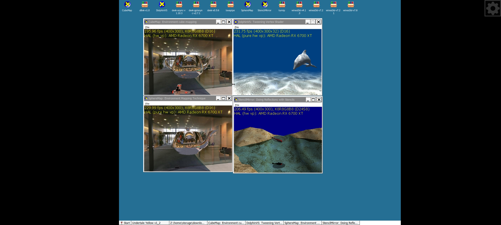

<!-- markdownlint-disable -->
<!-- cspell:disable -->

[](https://github.com/ocnedkf/GQE-emulator/blob/v0.4.1-beta/README-zh_CN.md)
[](README.md)

> [!NOTE]
> You are currently in the v0.4.1-beta channel.

> [!WARNING]
> This emulator is currently in beta and may contain undiscovered bugs. We apologize for any inconvenience and appreciate your understanding.

# GQE-emulator

GQE is an emulator that runs Windows x86_64 programs on Android ARM64 devices without root access. It relies on [Termux](https://github.com/termux/termux-app), [Termux-X11](https://github.com/termux/termux-x11), and [InputBridge](https://inputbridge.net/).



Have an improvement? Submit a pull request—we welcome constructive contributions.

# Installation

Run the following command in Termux. Make sure to use the 64-bit version.

```bash
curl -s -o g https://raw.githubusercontent.com/ocnedkf/GQE-emulator/refs/heads/v0.4.1-beta/install-sh && chmod +x g && ./g
```

# Launch GQE

Run:

```bash
start-gqe
```

> [!IMPORTANT]
> Ensure that enough RAM is available while GQE is running to prevent Termux from being terminated in the background.

# Terminate GQE

Close all GQE windows, or run:

```bash
kill-gqe
```

# GQE Settings

Open the settings menu with `start-gqe -s` or `start-gqe --settings`.

The menu provides the following options:

- **Display:** Select a preset resolution or enter a custom resolution in `WIDTHxHEIGHT` format. You can also enter a DPI value. If the resolution is missing or invalid, GQE uses `1024x768`; invalid DPI values are ignored.
- **Audio:** Enter and save an audio latency value in milliseconds.
- **Wine:** Configure DLL overrides or view Wine information.
- **Drive letters:** Add, remove, or view drive-letter mappings.
- **More settings:** Save a time zone ID, edit configuration files, select the WineD3D or VirGL graphics backend, and set a custom BMP wallpaper.

# GQE Configuration

> [!TIP]
> In the Start Menu, use the `Install` and `Programs` options to adjust Mesa and D3D files. You can also use `winecfg` and other tools to configure GQE quickly.

Configuration files are located at:

```text
/storage/emulated/0/.gqe-start
```

| File name | Description |
| --- | --- |
| `all_var.txt` | GQE global environment variables |
| `dxvk_settings` | DXVK configuration file |
| `mesa_var.txt` | Mesa Gallium driver selection |
| `mesa_var_v.txt` | Mesa Vulkan driver selection |
| `mesa_var_f.txt` | Path to the Vulkan ICD JSON manifest file |
| `log.txt` | Wine runtime log file |

# Repair GQE

Run `start-gqe -f` to repair or reinitialize the Wine prefix.

> [!TIP]
> If you want to reinitialize the Wine prefix, delete it before running the repair command
>
> Wine prefix directories are as follows:
> 
> ```text
> $HOME/.gqe-data-v0.4/.wine
> ```

# Uninstallation

Run the following command:

```bash
curl -s -o u https://raw.githubusercontent.com/ocnedkf/GQE-emulator/refs/heads/v0.4.1-beta/uninstall-gqe && chmod +x u && ./u
```

> [!WARNING]
> This command deletes GQE and all data stored in it. Do not run it unless GQE is installed.

# Device Requirements

- Android ARM64 device
- Android 8 or newer
- At least approximately 5.5 GB of available storage

# Third-Party Applications

- [7-Zip](https://7-zip.org/) - GNU LGPL v2.1 or later; 7z.dll also contains BSD-2-Clause/BSD-3-Clause components and an unRAR license restriction.
- [Box64 (Custom)](https://github.com/Pipetto-crypto/box64) - MIT License
- [D7VK](https://github.com/WinterSnowfall/d7vk) - zlib License
- [D8VK](https://github.com/AlpyneDreams/d8vk) - zlib License
- [DXVK](https://github.com/doitsujin/dxvk) - zlib License
- [DXVK-ASYNC](https://github.com/Sporif/dxvk-async)
- [DXVK-GPLASYNC](https://gitlab.com/Ph42oN/dxvk-gplasync)
- [InputBridge](https://inputbridge.net/)
- [Mesa](https://gitlab.freedesktop.org/mesa/mesa/) - MIT License for most code; component and file licenses vary.
- [Mesa-Turnip (Custom)](https://github.com/K11MCH1/WinlatorTurnipDrivers)
- [Mesa-VirGL (Custom)](https://github.com/alexvorxx/Mesa-VirGL)
- [Proton-Wine (Custom)](https://github.com/ocnedkf/proton-wine-custom) - GNU LGPL v2.1 or later
- [Termux-APP](https://github.com/termux/termux-app) - GPL-3.0-only, with stated exceptions for bundled libraries
- [Termux-Glibc-Packages](https://github.com/termux-pacman/glibc-packages) - MIT License
- [Termux-Packages](https://github.com/termux/termux-packages) - Apache License 2.0 for build infrastructure; package scripts and patches follow each package's license.
- [Termux-X11](https://github.com/termux/termux-x11) - GPL-3.0
- [Tiny File Manager](https://github.com/radzikpwnz/tfm) - MIT License
- [Ubuntu-Packages](https://packages.ubuntu.com/noble/)
- [VKD3D](https://github.com/HansKristian-Work/vkd3d-proton) - GNU LGPL v2.1 or later
- [Wine (Custom)](https://github.com/ocnedkf/wine-custom) - GNU LGPL v2.1 or later
- [Wine-Gecko](https://gitlab.winehq.org/wine/wine-gecko) - MPL-2.0 for most code, plus LGPL, GPL, and other third-party licenses.
- [Wine-Mono](https://gitlab.winehq.org/mono/wine-mono) - Multiple licenses, including MIT/X11, LGPL, GPL with exceptions, BSD, zlib, and MS-PL.
- [WineD3D](https://gitlab.winehq.org/wine/wine/-/tree/master/dlls/wined3d) - **Precompiled by** [Federico Dossena](https://fdossena.com/?p=wined3d/index.frag) - GNU LGPL v2.1 or later
